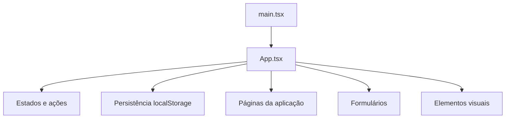
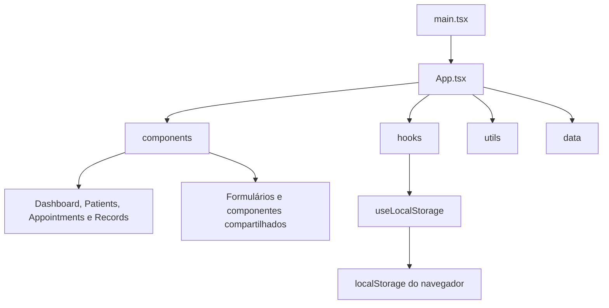

# Arquitetura e dependências

## Visão geral

O ClinicFlow é uma aplicação web demonstrativa desenvolvida com React e TypeScript para apoiar tarefas de gerenciamento de uma clínica.

A aplicação não possui backend próprio. Os dados de demonstração e as alterações realizadas durante o uso são armazenados no `localStorage` do navegador, por meio do hook `useLocalStorage`. Por isso, o sistema não deve ser utilizado para armazenar dados reais de pacientes.

## Organização dos arquivos

```text
src/
├── App.test.tsx
├── App.tsx
├── main.tsx
├── styles.css
├── types.ts
├── components/
│   ├── AppointmentForm.tsx
│   ├── Appointments.tsx
│   ├── Appointments.test.tsx
│   ├── Dashboard.tsx
│   ├── Modal.tsx
│   ├── NoteForm.tsx
│   ├── PatientForm.tsx
│   ├── Patients.tsx
│   ├── Records.tsx
│   ├── Shared.tsx
│   └── Sidebar.tsx
├── data/
│   └── seed.ts
├── hooks/
│   └── useLocalStorage.ts
├── test/
│   └── setup.ts
└── utils/
    └── clinicHelpers.ts
```

## Responsabilidade dos principais arquivos

| Arquivo | Responsabilidade |
|---|---|
| `main.tsx` | Inicializa a aplicação React. |
| `App.tsx` | Coordena estados, ações, navegação e montagem das áreas. |
| `types.ts` | Define os tipos de pacientes, consultas e prontuários. |
| `data/seed.ts` | Fornece dados fictícios para demonstração. |
| `hooks/useLocalStorage.ts` | Centraliza leitura e gravação no armazenamento local. |
| `utils/clinicHelpers.ts` | Reúne funções auxiliares, como formatação de datas e busca de pacientes. |
| `components/Sidebar.tsx` | Apresenta o menu lateral. |
| `components/Modal.tsx` | Controla a apresentação de janelas modais. |
| `components/Shared.tsx` | Reúne elementos visuais compartilhados. |
| `components/Dashboard.tsx` | Apresenta o painel inicial. |
| `components/Patients.tsx` | Gerencia a apresentação dos pacientes. |
| `components/Appointments.tsx` | Gerencia a apresentação das consultas. |
| `components/Records.tsx` | Apresenta os registros de evolução. |
| `components/PatientForm.tsx` | Formulário de cadastro de pacientes. |
| `components/AppointmentForm.tsx` | Formulário de agendamento. |
| `components/NoteForm.tsx` | Formulário de registro de evoluções. |
| `App.test.tsx` | Testes de integração da aplicação. |
| `components/Appointments.test.tsx` | Teste do mapeamento dos status das consultas. |
| `test/setup.ts` | Configura o ambiente de testes. |

## Arquitetura antes das refatorações

Na versão original, várias responsabilidades estavam concentradas em `App.tsx`, incluindo páginas, formulários, funções auxiliares, estados e persistência.



## Arquitetura após as refatorações

As responsabilidades foram distribuídas entre componentes, hooks e módulos auxiliares. O `App.tsx` continua coordenando a aplicação, mas não concentra mais toda a implementação das páginas e dos formulários.



## Direção das dependências

A aplicação segue uma organização em que o componente principal coordena os componentes de interface e utiliza módulos auxiliares para tarefas específicas.

- `main.tsx` inicializa a aplicação.
- `App.tsx` coordena os estados e fornece dados e funções aos componentes.
- Os componentes recebem propriedades para apresentar informações e executar ações.
- O hook `useLocalStorage` concentra a persistência.
- O módulo `clinicHelpers` fornece funções reutilizáveis.
- O módulo `data/seed.ts` fornece os dados iniciais.

Não foi implementada uma camada de injeção de dependência. A comunicação entre os componentes ocorre principalmente por propriedades (*props*) e funções de callback.

Não foi identificada necessidade de criar uma estrutura de backend ou serviços externos para o escopo demonstrativo do projeto.

## Mudanças realizadas

As principais alterações de organização foram:

- Extração de componentes compartilhados.
- Centralização da persistência no hook `useLocalStorage`.
- Separação das páginas em componentes próprios.
- Separação dos formulários.
- Agrupamento dos parâmetros do Dashboard em objetos `data` e `actions`.
- Substituição da condicional ternária encadeada dos status por um objeto de mapeamento.

Essas mudanças reduziram a concentração de código no arquivo principal e deixaram as responsabilidades mais claras.

## Impacto nos testes

A separação dos componentes facilitou a validação de comportamentos específicos. Os testes existentes verificam indicadores do painel, filtros, cadastro, persistência, conclusão de consultas, histórico, exclusão de pacientes e mapeamento dos status.

A cobertura atual é de 80,65% para instruções e linhas, 81,73% para branches e 63,49% para funções.

## Limites da arquitetura

O sistema não possui API própria nem banco de dados em servidor. O armazenamento local é utilizado apenas para demonstração e não oferece os controles de segurança e compartilhamento necessários para informações clínicas reais.

O `App.tsx` ainda coordena diversas operações e permanece como ponto central da aplicação. Essa responsabilidade é compatível com o tamanho atual do projeto, mas pode ser reavaliada caso novas funcionalidades sejam adicionadas.

## Evidências

- Inicialização: `src/main.tsx`.
- Componente principal: `src/App.tsx`.
- Persistência: `src/hooks/useLocalStorage.ts`.
- Funções auxiliares: `src/utils/clinicHelpers.ts`.
- Componentes: `src/components/`.
- Testes: `src/App.test.tsx` e `src/components/Appointments.test.tsx`.
- Histórico das alterações: PRs de refatoração no GitHub.

## Roteiro de 1 minuto

Na versão original, grande parte do sistema estava concentrada no `App.tsx`. Durante as refatorações, separamos as páginas, formulários e elementos compartilhados, além de centralizar a persistência em um hook. Também organizamos os parâmetros do Dashboard e simplificamos a lógica dos status das consultas. O sistema continua utilizando o armazenamento local do navegador e não possui backend, sendo destinado apenas à demonstração.